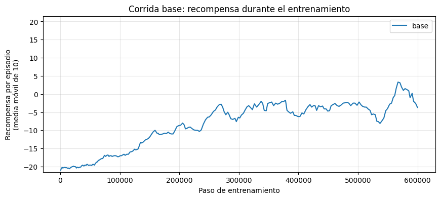
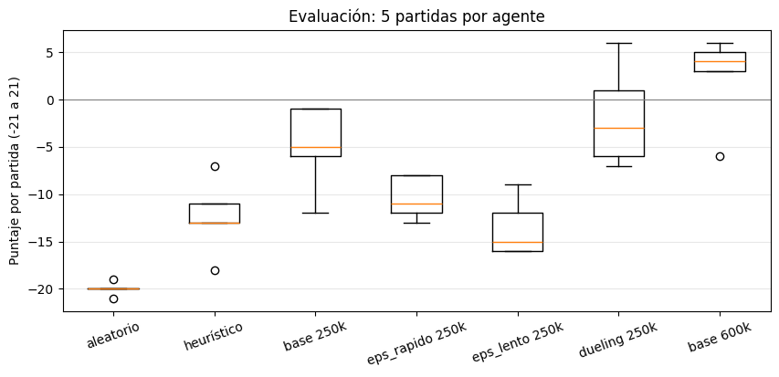

# Taller 2 — Aprendizaje profundo por refuerzo: Double DQN en Pong

**Aprendizaje Profundo** · Maestría en Inteligencia Artificial · Pontificia Universidad Javeriana · Periodo 2026-30

**Estudiante:** Daniel Sebastian Velasco Munar (trabajo individual)
**Profesor:** Andrés Darío Moreno Barbosa

[](https://colab.research.google.com/github/DANIEL-VELASCO/taller2-double-dqn-pong/blob/main/Taller_2_Aprendizaje_profundo__202630.ipynb)

---

## Descripción

Se entrena y evalúa un agente **Double DQN** que aprende a jugar **Pong de Atari** (`ALE/Pong-v5`) a partir de los píxeles de la pantalla, con TensorFlow y Keras. El taller cubre cinco actividades:

1. Ciclo de entrenamiento de Double DQN.
2. Exploración ε-greedy con distintas tasas de decaimiento de ε.
3. Análisis de los valores Q, los objetivos TD y el error TD.
4. Revisión de la arquitectura y variante **Dueling**.
5. Evaluación frente a un agente aleatorio y un agente heurístico que sigue la pelota.

## Resultados principales

Evaluación con ε = 0.01 en 5 partidas (puntaje de −21 a +21):

| Agente | Puntaje medio | Q medio | Retorno real |
|---|:---:|:---:|:---:|
| Aleatorio | −20.0 | – | – |
| Heurístico (sigue la pelota) | −12.4 | – | – |
| Double DQN, 250 000 pasos | −5.0 | 1.10 | −0.16 |
| Dueling, 250 000 pasos | −1.8 | 0.83 | −0.05 |
| **Double DQN, 600 000 pasos** | **+2.4** | 1.34 | 0.08 |

- El agente final ganó 4 de las 5 partidas y superó al heurístico por casi 15 puntos.
- Bajar ε a 0.02 en 100 000 pasos funcionó mejor que hacerlo más rápido (20 000 pasos) o más lento (hasta 0.10 en 250 000 pasos).
- La cabeza Dueling aprendió más rápido, con casi el mismo número de parámetros.
- El Q predicho quedó por encima del retorno real en todos los agentes: Double DQN redujo la sobreestimación, pero no la eliminó.

<p align="center">
  
  
</p>

## Estructura

```
├── informe/                 Informe en formato IEEE Transactions on AI (PDF y Word)
├── resultados/
│   ├── figuras/             Figuras usadas en el informe
│   ├── evaluacion_final.csv
│   └── resumen_entrenamiento.csv
├── Taller_2_Aprendizaje_profundo__202630.ipynb   Notebook con el código y sus salidas
├── requirements.txt
└── README.txt               README de la entrega
```

## Experimentos

| Corrida | Cambio frente a `base` | Pasos |
|---|---|:---:|
| `base` | red original de Mnih et al. (2015); ε de 1.0 a 0.02 en 100 000 pasos | 600 000 |
| `eps_rapido` | ε de 1.0 a 0.02 en 20 000 pasos | 250 000 |
| `eps_lento` | ε de 1.0 a 0.10 en 250 000 pasos | 250 000 |
| `dueling` | cabeza Dueling (Wang et al., 2016) del mismo tamaño | 250 000 |

Las corridas se comparan sobre sus primeros 250 000 pasos, con la misma semilla y los mismos pesos iniciales.

## Cómo ejecutar

1. Abrir el notebook en Google Colab con GPU (*Entorno de ejecución → Cambiar tipo de entorno de ejecución → T4 GPU*).
2. Ejecutar las celdas en orden. La sección 6.1 monta Google Drive; los pesos y las métricas se guardan en `MyDrive/taller2_pong/`.
3. Si Colab se desconecta, ejecutar de nuevo las celdas hasta la 6.3 y luego la celda de la corrida: continúa desde el último guardado.
